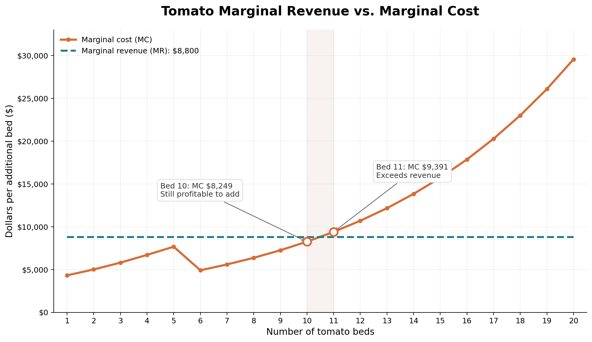

# Perfect Competition: Economic Analysis

## 1. Profit Maximization and the Tomato Decision

The farm's goal is to maximize profit rather than use every available resource. Although the farm has 64 planting beds, the model recommends using only 60. Using every available bed would not necessarily increase profit because additional production also increases labor and operating costs. Revenue might increase, but that does not mean the farm will become more profitable.

Tomatoes generate the highest revenue per bed at $8,800, but they also have the highest diminishing-returns rate at 10%. As more tomato beds are planted, the amount of labor required increases at a faster rate. According to the Marginal Cost worksheet, the tenth tomato bed has a marginal cost of $8,248.59, which is below its revenue of $8,800. However, the eleventh bed has a marginal cost of $9,390.72, exceeding the additional revenue by $590.72.

This helps explain why the model recommends planting 10 tomato beds instead of the maximum of 20. The farm must consider the additional cost of production rather than focusing only on how much revenue each crop generates.

*Figure 1. Tomato marginal cost compared with revenue per additional bed. Source: Marginal Cost worksheet.*

## 2. Marginal Costs and Diminishing Returns

One of the interesting findings in the model was the temporary decrease in tomato marginal cost around bed 6. Marginal cost decreases from approximately $7,660.86 at bed 5 to $4,906.28 at bed 6, before increasing to $5,585.71 at bed 7.

This decrease is related to the farm's labor cost structure. The owner contributes a maximum of 720 fieldwork hours per season, valued at approximately $34.72 per hour. Once those hours are exhausted, the farm uses temporary workers at approximately $17.36 per hour. Since temporary workers cost less per hour, the blended labor rate decreases as more work shifts toward temporary labor.

However, cheaper labor does not eliminate diminishing returns. As more tomato beds are planted, each additional bed requires increasingly more labor hours. Eventually, the additional labor requirements outweigh the savings from cheaper temporary workers, causing marginal costs to increase again.

The crops also have different diminishing-returns rates. Tomatoes have the highest rate at 10%, followed by carrots at 2.5% and mesclun at 1.25%. These differences help explain why expanding tomato production becomes more expensive more quickly than expanding the other crops.

*Figure 2. Marginal cost schedules for tomatoes, carrots, and mesclun. Source: Marginal Cost worksheet.*

## 3. Resource Constraints and Their Economic Value

The model recommends planting 60 of the 64 available beds, leaving four unused. The farm also uses approximately 5,277.22 of its 6,480 available labor hours, leaving 1,202.78 hours unused. Therefore, the overall land and labor constraints are nonbinding.

However, the crop-specific constraints for carrots and mesclun are binding because the model recommends planting their maximum permitted quantities of 20 and 30 beds. The tomato constraint is nonbinding because only 10 of the permitted 20 beds are planted.

These results demonstrate that having excess resources does not mean the farm should automatically use them. The farm should expand production only when doing so increases overall profit.

The binding carrot and mesclun limits may have economic value because relaxing them could allow the farm to produce additional profitable beds. However, the value of relaxing either constraint cannot be determined from its binding status alone. The model would need to be tested with higher crop limits to calculate the resulting change in profit.

## 4. Standalone Profitability and Production Decisions

The farm must also consider whether each crop can generate enough revenue to cover its costs when produced independently.

Tomatoes have the highest revenue per bed, but their labor requirements increase quickly because of diminishing returns. Carrots and mesclun generate less revenue per bed, but their lower diminishing-returns rates allow labor requirements to increase more gradually.

The marginal-cost schedules help identify when additional production stops contributing positively to profit. However, marginal cost alone does not establish whether a crop can cover all its costs. The farm must also consider average variable cost (AVC) and fixed costs.

Under the short-run production rule, a crop should generally continue operating when its selling price covers average variable cost, even if it does not cover all fixed costs. A crop may still generate a loss after fixed costs are included, so the distinction between operating and being profitable is important.

The standalone schedules provide the revenue and variable-cost information needed for this comparison. A final standalone profitability conclusion would require calculating each crop's total contribution and specifying how the farm's $20,000 fixed cost is treated when evaluating a crop independently.

## 5. Comparison With My Original Hypothesis

My original prediction was to plant 18 tomato beds, 18 carrot beds, and 25 mesclun beds. I expected tomatoes to contribute significantly to profit because they generated the highest revenue per bed.

What surprised me most about the results was how much labor tomato production required. I underestimated how quickly labor requirements would increase as more beds were planted. My original allocation required approximately 11,384 labor hours, which exceeded the farm's available 6,480 hours.

The final model recommends 10 tomato beds, 20 carrot beds, and 30 mesclun beds. This allocation generates approximately $42,761.66 in seasonal profit while remaining within the farm's available land and labor capacity.

This comparison helped me understand that maximizing revenue is not the same as maximizing profit. A crop may generate high revenue, but the additional costs required to produce it can make further expansion a poor decision.

## 6. Conclusion and Recommendation

I recommend that the farm follow the model's allocation of 10 tomato beds, 20 carrot beds, and 30 mesclun beds. This combination produces approximately $42,761.66 in seasonal profit while satisfying the farm's resource constraints.

Although four planting beds and approximately 1,203 labor hours remain unused, this does not mean the farm is operating inefficiently. The goal is to maximize profit rather than use every available resource.

I would reconsider this recommendation if crop prices, labor costs, or available resources changed. For example, higher tomato prices or lower temporary labor costs could make additional tomato beds more profitable. However, I would rerun the Excel model before changing the allocation to ensure that the decision continues to support profit maximization.

Overall, this analysis showed me the importance of considering marginal costs, diminishing returns, and resource constraints when making production decisions.
